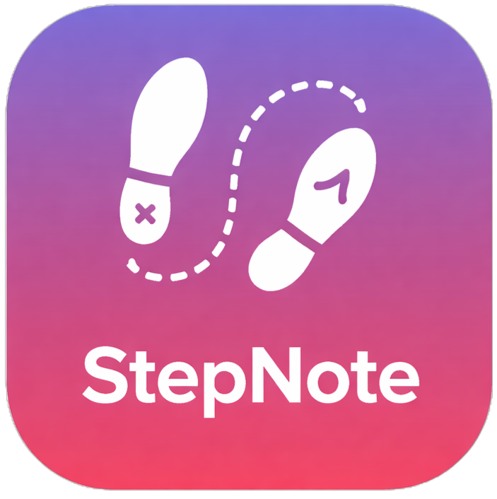
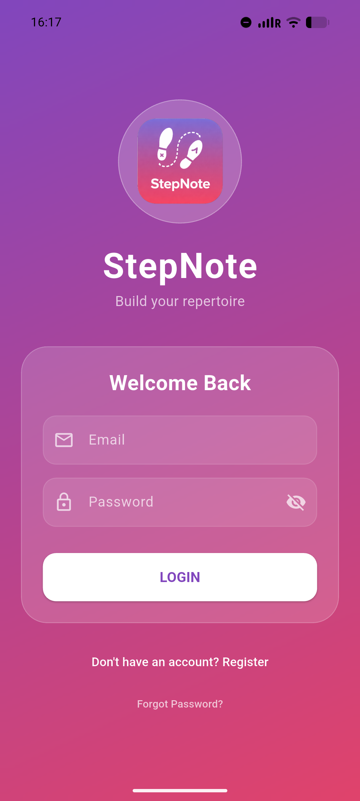
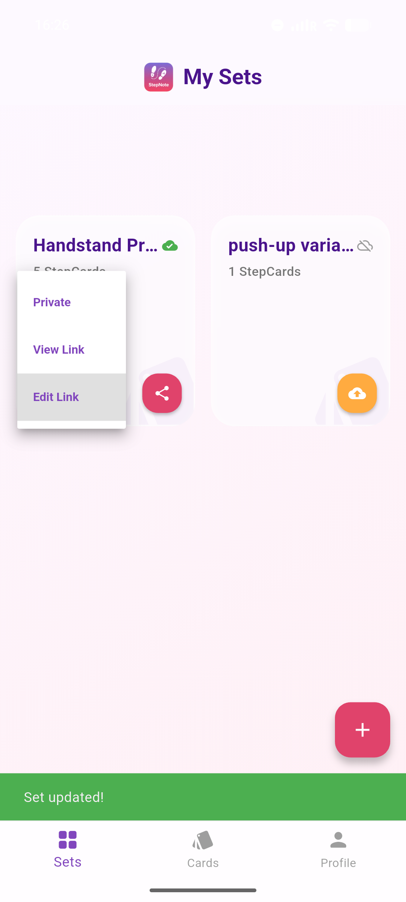
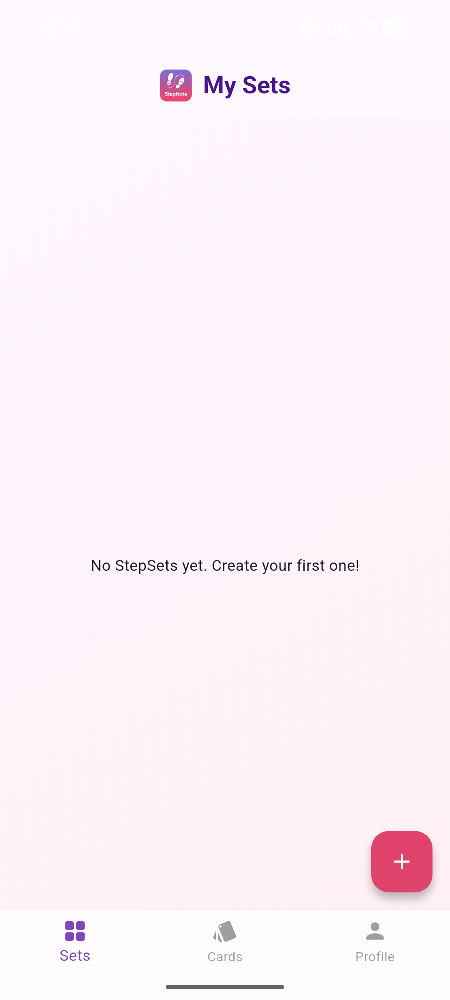
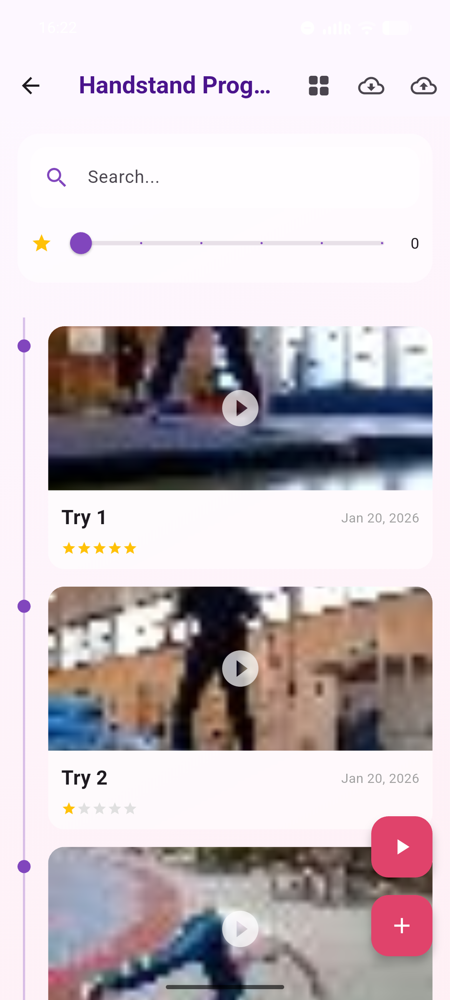
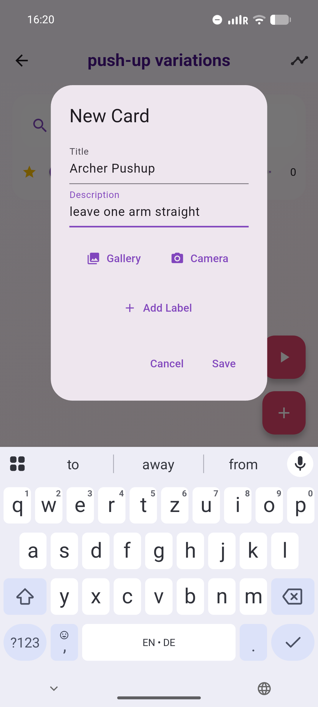
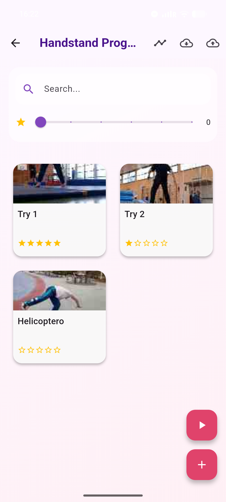
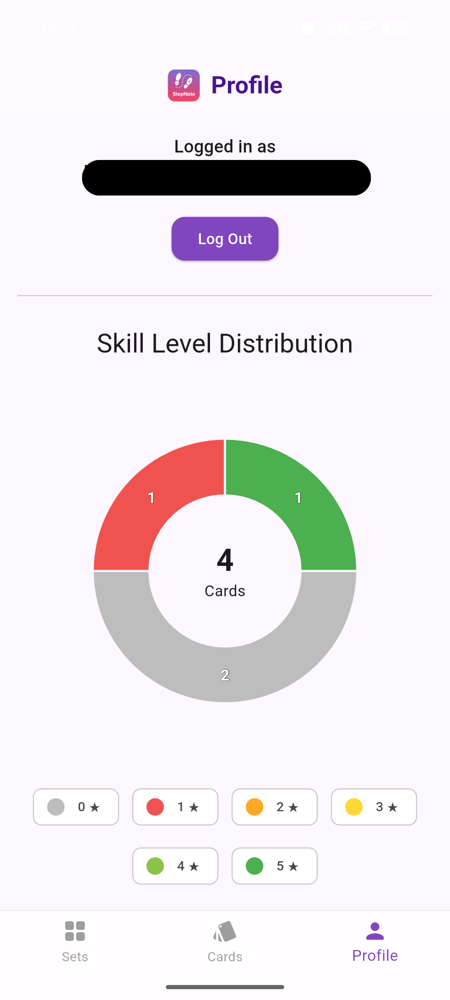

  

# StepNote - Flashcard Trainer

A modern, dynamic, and collaborative vocabulary training application built with Flutter. StepNote allows users to create personalized flashcard sets with rich media (videos/images), organize them into sets, and share them with friends or students via secure cloud links.

---

## ✨ Showcase

Experience a sleek, "glassy" design with smooth animations and intuitive navigation.

  
  
  
  

  
  
  
  

---

## 🚀 Key Features

### 🎬 Media-Rich Flashcards
Create cards with titles, descriptions, and attach videos or images directly from your gallery or camera. Integrated video progress tracking allows for visual learning.

### 🤝 Collaborative Sharing
Share your sets via a unique link with granular permissions (View-only or Collaborative editing).

### 📈 Progression Mode
Toggle between a standard **Grid View** and a **Progression Timeline** to visualize your learning journey chronologically.

### ☁️ Cloud Sync
Seamless automatic backup and multi-device synchronization powered by Firebase.

### 📱 Local-First Architecture
Full offline support with SQLite, ensuring a snappy and reliable experience regardless of connectivity.

---

## 🛠️ How to Use

1.  **Create a Set:** Tap the '+' button on the main screen. Choose visibility (Private, Public View, Public Edit).
2.  **Add Cards:** Inside a set, tap the '+' FAB. Add text and video.
3.  **Share:** Tap the Share icon on a public set to generate a link. Send this link to a friend.
4.  **Join:** Tapping a shared link automatically opens StepNote, joins the set, and downloads it.
5.  **Sync:** Tap **Upload** to push local changes or **Download** to pull collaborator updates.
6.  **Progression:** Toggle the view icon in the top bar to switch between Grid and Timeline views.

---

## 🏗️ Architecture

StepNote follows a clean architecture using **Dependency Injection** (GetIt) and the **Repository Pattern**.

-   **Services:** Low-level APIs for SQLite, Firebase, and Auth.
-   **Repositories:** Managed data flow between local storage and the cloud.
-   **UI:** Reactive Flutter widgets using `FutureBuilder` and `StreamBuilder`.

See [docs/Architecture.md](docs/Architecture.md) for details.

---

## 🧪 Technology Stack

- **Framework:** [Flutter](https://flutter.dev)
- **Local Database:** SQLite (`sqflite`)
- **Cloud Backend:** Firebase (Auth, Firestore, Storage)
- **Deep Linking:** `app_links`
- **Video:** `video_player`, `easy_video_editor`
- **State Management:** Repository Pattern + `get_it`

---

## 🏁 Getting Started

1.  **Install Dependencies:** `flutter pub get`
2.  **Generate Launcher Icons:** `dart run flutter_launcher_icons`
3.  **Run the App:** `flutter run`
